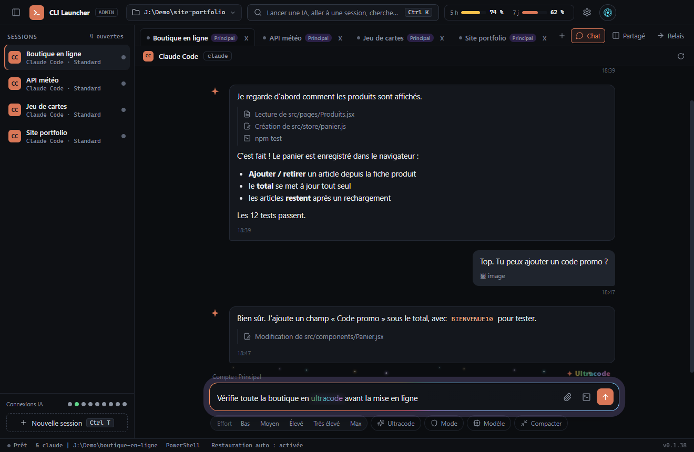
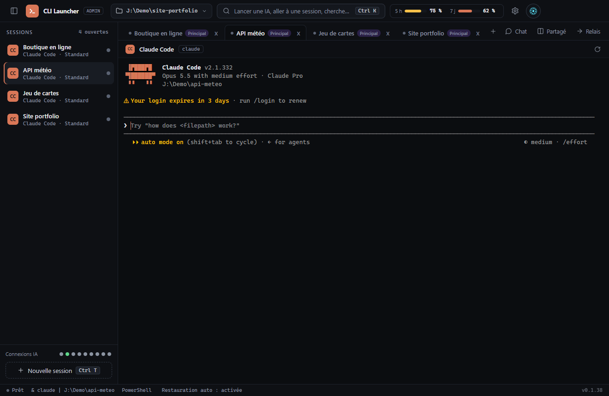
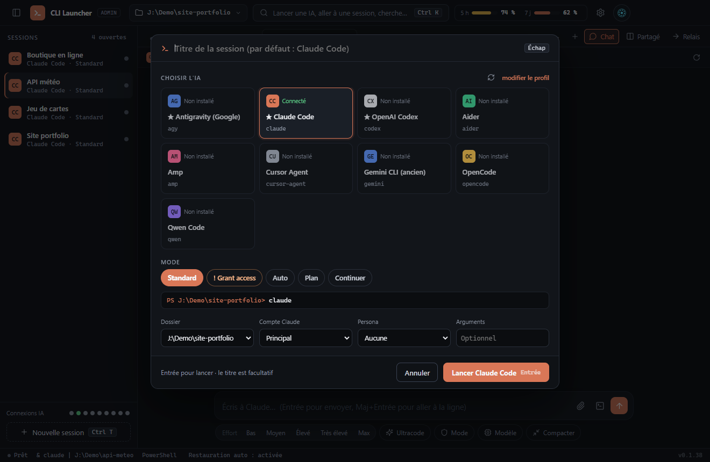
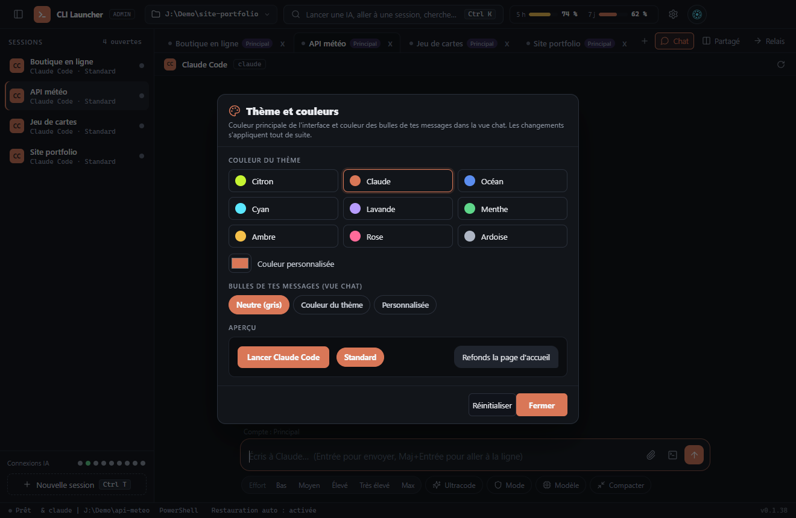

# IA CLI Launcher

Application Windows et Linux pour lancer des CLI IA dans des onglets terminal nommables, depuis le dossier de travail choisi avant le lancement.

Le code source est unique : les deux versions evoluent ensemble. Une couche d'abstraction (`src/main/platform.js`) isole les differences entre systemes (shell, quoting, detection de commande, droits eleves).

## Installation

- **Windows** : telecharge `IA-CLI-Launcher-Setup-<version>.exe` dans la [derniere version](https://github.com/TheViking83230/ia-cli-launcher/releases/latest). L'installateur maison (fenetre aux couleurs du logiciel) propose le raccourci Bureau, JARVIS et le lancement a la fin. Le fichier `IA-CLI-Launcher-<version>-x64.exe` (installateur NSIS classique) sert aux mises a jour automatiques.
- **Linux** : paquet `.deb` ou `AppImage` dans la meme page.

## Apercu

> Captures realisees avec des projets fictifs (dossier de demonstration).

### Vue chat



La conversation d'un onglet Claude s'affiche en bulles, comme sur claude.ai (bouton `Chat` ou Ctrl+Maj+K). Sous la zone de saisie :

- **Effort** : Bas, Moyen, Eleve, Tres eleve, Max (commande `/effort`, le niveau actif est surligne ; le changement n'encombre pas la conversation).
- **Ultracode** : active l'orchestration multi-agents de Claude pour tes demandes (contour arc-en-ciel anime autour de la saisie). Le mot « ultracode » tape dans un message est colore et anime. Attention, ce mode consomme beaucoup plus de quota.
- **Mode** (normal, editions auto, plan, auto), **Modele** (menu deroulant : Par defaut, Opus, Sonnet, Haiku) et **Compacter** (`/compact`).
- **Pieces jointes** : colle (Ctrl+V), glisse-depose ou choisis (trombone) des images, des GIF ou des fichiers. Une vignette s'affiche au-dessus de la saisie et part avec le message. Un GIF copie depuis une page web garde son animation.

### Terminal



Chaque session tourne dans un vrai terminal, avec la liste des sessions et leur statut a gauche, les onglets en haut et le quota Claude dans l'en-tete. L'en-tete sert de barre de titre : plus de barre Windows, les boutons de la fenetre prennent les couleurs du logiciel.

Raccourcis du terminal : **Ctrl+C copie** la selection (il n'interrompt plus la CLI), **Ctrl+V colle** (texte, images ou fichiers copies), **Ctrl+Maj+C interrompt** la CLI.

### Nouvelle session (Ctrl+T)



Choix de l'IA en cartes (avec son etat : connectee, sans token, non installee), du mode, du dossier, du compte Claude, de la persona et des arguments, avec l'apercu de la commande lancee.

### Theme et couleurs



Roue dentee > « Theme et couleurs » : 9 couleurs ou une couleur personnalisee pour l'interface, et la couleur des bulles de tes messages dans la vue chat.

## Fonctions

- Deux interfaces au choix (Reglages > Interface) : la nouvelle interface « Command Deck » (par defaut pour une nouvelle installation) et l'interface classique (conservee lors d'une mise a jour, avec une proposition d'essayer la nouvelle).
- Command Deck : liste des sessions avec leur statut (au travail / attend ta validation / inactive), palette « Nouvelle session » (Ctrl+T), palette de commandes (Ctrl+K) regroupant toutes les actions, en-tete compact (dossier et dossiers recents, Git, quota, reglages, JARVIS), bandeau de validation et notifications.
- Onglets terminal integres avec titre modifiable.
- Choix du dossier de lancement avant chaque session.
- Menu gauche retractable pour garder seulement les onglets et le terminal visibles.
- Renommage d'onglet via le titre en haut, le bouton crayon, ou double-clic sur l'onglet.
- Sessions lancees dans PowerShell sous Windows, et dans le shell par defaut de l'utilisateur (`$SHELL`, repli `bash`) sous Linux.
- Profils inclus pour Claude Code, OpenAI Codex, Gemini CLI, Qwen Code, Aider, OpenCode, Cursor Agent et Amp.
- Favoris multiples: les profils favoris remontent en haut de la liste.
- Etat tokens par IA: detection locale des variables d'environnement et fichiers de connexion connus, sans afficher les secrets.
- Bouton d'installation par profil, lance dans un onglet terminal.
- Modes configurables par profil, dont les modes grant access quand ils sont documentes par le CLI.
- Ajout de profils CLI personnalises.
- Glisser-deposer de fichier: le chemin est colle dans le terminal actif (dans la vue chat : ajoute en piece jointe).
- Copier / coller habituels dans le terminal : Ctrl+C copie, Ctrl+V colle, Ctrl+Maj+C interrompt.
- Build Windows: installateur maison `installer/setup.cc` (fenetre GDI+ sans bordure, construit par `scripts/build-setup.ps1`, contient l'installateur NSIS et le lance en silencieux) ; installateur NSIS aux couleurs du logiciel (theme sombre, en francais ; images generees par `build/installer-art.ps1`), raccourcis bureau/menu demarrer et execution admin.
- Build Linux: paquet `.deb` (raccourci dans le menu d'applications).
- Signature Authenticode via certificat PFX, avec option auto-signee pour les tests (Windows).

## Profils et modes

- Claude Code: `--dangerously-skip-permissions`, `--permission-mode auto`, `--permission-mode plan`, `--continue`.
- OpenAI Codex: `--sandbox workspace-write --ask-for-approval never`, `--dangerously-bypass-approvals-and-sandbox`, `--sandbox read-only`, `--search`.
- Gemini CLI: `--approval-mode=yolo`, `--approval-mode=auto_edit`, `--sandbox`, `--all-files`.
- Qwen Code: `--approval-mode yolo`, `--approval-mode auto-edit`, `--approval-mode plan`.
- Aider: `--yes-always`, `--browser`, `--auto-test`, `--dry-run`.
- OpenCode: le mode grant access cree `opencode.json` seulement s'il n'existe pas deja, avec `permission: "allow"`.
- Cursor Agent: `--force`, `--print --output-format text`.
- Amp: lancement standard et `login`.

## Sessions persistantes

Les onglets ouverts au moment de la fermeture sont memorises et repris au demarrage suivant, pour reprendre la conversation la ou elle s'etait arretee.

- Reprise automatique au lancement, pilotee par l'interrupteur `Restaurer les sessions au demarrage` du menu de gauche (toujours accessible). Un bandeau au demarrage permet aussi de la desactiver.
- Quand la CLI sait reprendre sa derniere conversation, la session est relancee avec son option native : Claude Code `--continue`, OpenAI Codex `resume --last`, OpenCode `--continue`, Cursor Agent `resume`, Aider `--restore-chat-history`.
- Pour les CLI sans reprise native (Gemini, Qwen, Amp), l'affichage du terminal precedent (jusqu'a 200 Ko par onglet) est rejoue pour retrouver le fil visuellement.
- Les donnees sont stockees localement dans le dossier de donnees utilisateur de l'application (`sessions.json` et un fichier d'historique par onglet sous `sessions/`). Aucun envoi reseau.

## Historique global

Le bouton `Historique` (icone horloge, en haut a droite) ouvre une fenetre qui regroupe **tous les echanges de tous les onglets**, sessions terminees comprises.

- Liste des sessions, la plus recente d'abord, avec CLI, mode, dossier et date.
- Champ de recherche : filtre sur le titre, le dossier, la commande et le mode, ainsi que dans le **contenu** des transcriptions.
- Apercu de la transcription complete d'une session dans un terminal en lecture seule, avec **coloration** (les couleurs ANSI d'origine sont preservees, rendu fidele meme pour les CLI plein ecran), et un bouton `Reprendre cette session` qui relance la CLI (avec reprise native quand elle est disponible). La recherche dans le contenu se fait sur le texte nettoye des codes couleur.
- Suppression d'une session precise (icone corbeille sur chaque ligne) ou bouton `Vider` pour tout effacer.
- Conservation locale : index `history.json` et une transcription par session (jusqu'a 512 Ko chacune) dans le dossier de donnees utilisateur, plafonnees aux 500 sessions les plus recentes. Aucun envoi reseau.

## Etat tokens

Le panneau `Tokens` affiche un statut par IA :

- vert : un token ou une configuration de connexion locale est detectee ;
- jaune : la CLI est detectee, mais aucun token/config connu n'est visible par l'application ;
- rouge : la CLI n'est pas detectee dans le `PATH`.

La verification est locale : aucune requete n'est envoyee aux APIs IA, et aucune valeur de token n'est affichee. Les variables prises en compte incluent notamment `OPENAI_API_KEY`, `ANTHROPIC_API_KEY`, `GEMINI_API_KEY`, `GOOGLE_API_KEY`, `DASHSCOPE_API_KEY`, `CURSOR_API_KEY` et `AMP_API_KEY`.

Si une variable d'environnement vient d'etre ajoutee, relancer l'application pour que les sessions terminal la voient aussi.

## Test sans installateur

```powershell
npm install
npm start
```

Pour produire un `.exe` de test sans installateur:

```powershell
npm run pack
```

Le resultat est dans `dist/win-unpacked/IA CLI Launcher.exe`.

## Installateur final

```powershell
npm run dist:installer
```

L'installateur est genere dans `dist/` et cree les raccourcis Windows.

### Mise a jour d'une installation existante

L'installateur Windows met a jour l'application en place quand une version est deja installee (meme emplacement, pas d'installation en double) : il suffit de lancer le nouvel installateur. Les donnees utilisateur, dont les **sessions persistantes**, sont conservees lors d'une mise a jour comme d'une desinstallation (`deleteAppDataOnUninstall: false`). Le dossier d'installation n'est plus modifiable (`allowToChangeInstallationDirectory: false`) afin de garantir une mise a jour fiable au meme endroit.

Pour qu'une nouvelle build soit reconnue comme une mise a jour, incrementer `version` dans `package.json` avant de reconstruire.

## Mises a jour automatiques (auto-update)

L'application se met a jour seule via `electron-updater` et **GitHub Releases**. Au demarrage (puis toutes les 4 h), elle interroge le depot, telecharge la nouvelle version en arriere-plan et propose un bouton `Redemarrer pour installer`. Cela fonctionne sur **Windows (NSIS)** et **Linux (AppImage)**. Le `.deb` ne sait pas s'auto-mettre a jour : sous Linux, l'auto-update concerne le format AppImage.

Une verification manuelle est aussi possible via le menu **Fichier > Verifier les mises a jour** : un bandeau indique la recherche en cours, puis « deja la derniere version » ou propose le telechargement si une mise a jour existe.

### Configuration (une seule fois)

1. Le depot cible est `TheViking83230/ia-cli-launcher` (deja renseigne dans `package.json`, aux deux endroits : `repository.url` et `build.publish[0].owner`). Le creer sur GitHub s'il n'existe pas encore.
2. Creer un *Personal Access Token* GitHub avec la portee `repo` (ou `public_repo` pour un depot public) et l'exposer comme variable d'environnement avant de publier :

```powershell
$env:GH_TOKEN = "ghp_xxx"   # Windows / PowerShell
```
```bash
export GH_TOKEN="ghp_xxx"   # Linux / WSL
```

### Publier une nouvelle version

1. Incrementer `version` dans `package.json` (l'auto-update se declenche sur une version superieure).
2. Construire et publier :

```powershell
npm run release:win     # Windows : exe NSIS + latest.yml -> GitHub Release (draft)
```
```bash
npm run release:linux   # Linux/WSL : .deb + AppImage + latest-linux.yml -> meme Release
```

3. Sur GitHub, passer la release de *draft* a *published*. Les utilisateurs deja equipes d'une version installee recevront la mise a jour automatiquement.

> La premiere version embarquant l'auto-update doit etre installee manuellement ; les suivantes se mettront a jour seules. La signature de code (voir ci-dessous) est recommandee pour eviter les avertissements Windows lors des mises a jour.

## Signature numerique

Pour une vraie signature reconnue par Windows, fournir un certificat code-signing:

```powershell
$env:SIGN_PFX_PATH="C:\chemin\certificat.pfx"
$env:SIGN_PFX_PASSWORD="mot-de-passe"
npm run sign:pfx
```

Pour une signature locale de test:

```powershell
npm run sign:dev
```

La signature auto-signee indique que le fichier est signe, mais Windows ne l'affichera pas comme editeur public approuve sans certificat de confiance.

## Installateur Linux (.deb)

`electron-builder` ne peut pas produire un `.deb` depuis Windows : il faut un environnement Linux (WSL, machine ou VM Linux). Sur une machine Linux avec Node 18+ :

```bash
npm install
npm run dist:linux
```

Le paquet est genere dans `dist/` (`IA CLI Launcher-<version>-amd64.deb`).

### Depuis Windows via WSL

Un script automatise la copie du projet vers le systeme de fichiers Linux, l'installation des dependances et le packaging :

```powershell
wsl -d Ubuntu -e bash -lc "tr -d '\r' < '<chemin-wsl-du-projet>/scripts/build-linux.sh' > /tmp/b.sh && bash /tmp/b.sh '<chemin-wsl-du-projet>'"
```

`<chemin-wsl-du-projet>` est le chemin du depot vu depuis WSL (ex. `/mnt/c/Users/.../ia-cli-launcher`). Prerequis dans la distribution WSL : Node 18+ **Linux** (le Node Windows ne convient pas), plus `dpkg`, `fakeroot` et `curl`. Le `.deb` produit est recopie dans le `dist/` du projet.

### Installation du paquet

```bash
sudo apt install ./IA\ CLI\ Launcher-<version>-amd64.deb
# Desinstallation :
sudo apt remove ia-cli-launcher
```

La meme commande met a jour une installation existante des lors que le numero de `version` du paquet est plus eleve (meme nom de paquet `ia-cli-launcher`) : `apt`/`dpkg` remplace l'ancienne version en place. Les donnees utilisateur (sessions persistantes, dans le dossier personnel) ne sont pas touchees. Pour reinstaller la meme version, ajouter `--reinstall`.

## Icones

Les icones de l'application sont dans `build/` (`icon.png` pour Linux, `icon.ico` pour Windows). Pour les regenerer a partir de la marque "IA" :

```powershell
powershell -ExecutionPolicy Bypass -File scripts/make-icon.ps1
```

## Sources de documentation

- Claude Code CLI: https://code.claude.com/docs/en/cli-reference
- Claude Code permission modes: https://code.claude.com/docs/en/permission-modes
- OpenAI Codex CLI: https://developers.openai.com/codex/cli
- OpenAI Codex command options: https://developers.openai.com/codex/cli/reference
- Gemini CLI configuration: https://google-gemini.github.io/gemini-cli/docs/get-started/configuration.html
- Qwen Code approval mode: https://qwenlm.github.io/qwen-code-docs/en/users/features/approval-mode/
- Aider install/options: https://aider.chat/docs/install.html et https://aider.chat/docs/config/options.html
- OpenCode install/permissions: https://opencode.ai/docs/ et https://opencode.ai/docs/permissions/
- Cursor CLI: https://docs.cursor.com/en/cli/reference/parameters
- Amp manual: https://ampcode.com/manual
